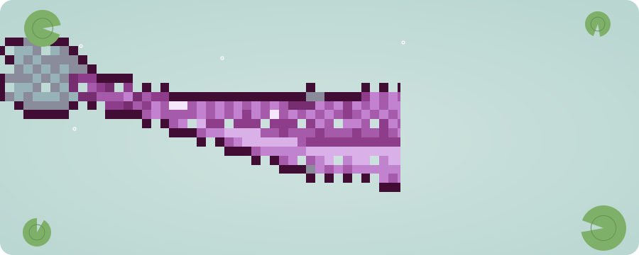

<!-- Images in assets/ are generated by build.py. Edit the stack there, then run: py build.py -->

<picture>
  <source media="(prefers-color-scheme: dark)" srcset="./assets/hero-dark.svg" />
  
</picture>

[Portfolio](https://www.jcportfolio.dev/) &nbsp;·&nbsp; [LinkedIn](https://www.linkedin.com/in/john-carlo-espina-61a2a9424/) &nbsp;·&nbsp; [Facebook](https://www.facebook.com/carlo.espina.7906)

### Stack

<picture>
  <source media="(prefers-color-scheme: dark)" srcset="./assets/stack-dark.svg" />
  
</picture>

### Activity

<picture>
  <source media="(prefers-color-scheme: dark)" srcset="./assets/pond-dark.svg" />
  
</picture>
