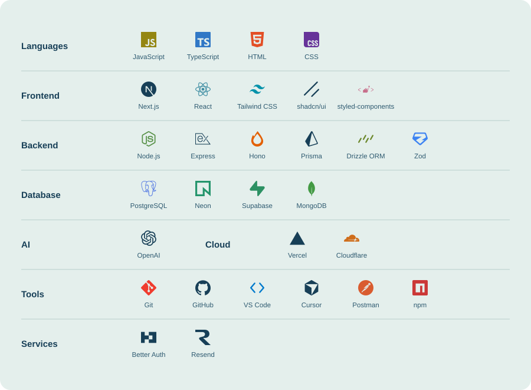

<!-- Images in assets/ are generated by build.py. Edit the stack there, then run: py build.py -->

<picture>
  <source media="(prefers-color-scheme: dark)" srcset="./assets/hero-dark.svg" />
  
</picture>

[LinkedIn](https://www.linkedin.com/in/john-carlo-espina-61a2a9424/) &nbsp;·&nbsp; [Facebook](https://www.facebook.com/carlo.espina.7906)

For our thesis we shipped a platform with machine-learning forecasts and over a thousand tests. I learn by building: when I pick up something new, I make something small with it the same week.

### Tech stack

<picture>
  <source media="(prefers-color-scheme: dark)" srcset="./assets/stack-dark.svg" />
  
</picture>

### Things I've built

**[StackPack CLI](https://github.com/espinajc2004-max/StackPack)** 
A local-first terminal tool that scaffolds JavaScript and TypeScript projects with curated integrations. Published on npm.

**Pollen** 
An AI study app. Upload a lecture PDF or photo and it writes quizzes, flashcards and notes, each answer linked to the page it came from.

**PistachiUI** 
An open-source component library with its own look, built on the shadcn registry.

**Auggregates**, our thesis 
A web and mobile operations system for an aggregates supplier, with an AI assistant and a budget-overrun forecast.

### Activity

<picture>
  <source media="(prefers-color-scheme: dark)" srcset="https://github-readme-activity-graph.vercel.app/graph?username=espinajc2004-max&custom_title=Contributions%20this%20month&bg_color=0b2a45&color=9dbcc8&title_color=dceae6&line=4fb3b0&point=dceae6&area=true&area_color=4fb3b0&hide_border=true&radius=18" />
  
</picture>

<picture>
  <source media="(prefers-color-scheme: dark)" srcset="https://github-readme-stats.vercel.app/api?username=espinajc2004-max&custom_title=GitHub&show_icons=true&count_private=true&hide_border=true&border_radius=18&bg_color=0b2a45&title_color=dceae6&text_color=9dbcc8&icon_color=4fb3b0&ring_color=4fb3b0" />
  
</picture>
<picture>
  <source media="(prefers-color-scheme: dark)" srcset="https://github-readme-stats.vercel.app/api/top-langs/?username=espinajc2004-max&custom_title=Languages&layout=compact&langs_count=6&hide_border=true&border_radius=18&bg_color=0b2a45&title_color=dceae6&text_color=9dbcc8" />
  
</picture>
